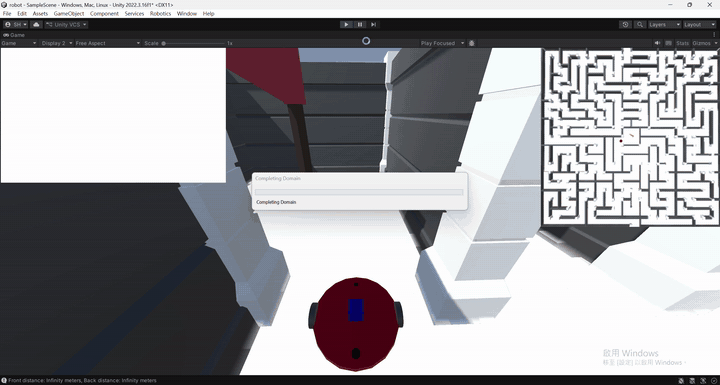
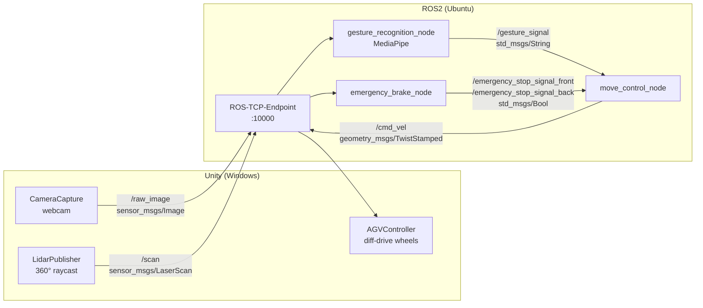

# Gesture-Controlled Robot Simulation via Unity–ROS2 Integration

Drive a simulated TurtleBot3 Waffle through a maze using **hand gestures** captured by your webcam.
A Unity digital twin streams camera frames and simulated LiDAR to ROS2, where MediaPipe recognizes gestures and a control stack turns them into safe velocity commands — no physical robot required.

> Final project for *Introduction to Robotics* at the University of Minnesota (Spring 2026).

<p align="center">
  
</p>

Full demo video: [`DEMO/DEMO_V0.mp4`](DEMO/DEMO_V0.mp4)

---

## Highlights

- **Unity digital twin** – TurtleBot3 Waffle imported via URDF Importer, driven by ArticulationBody wheel joints with differential-drive kinematics.
- **Full Unity ⇄ ROS2 bridge** – webcam images, 360° simulated LiDAR and velocity commands exchanged over ROS-TCP-Connector / ROS-TCP-Endpoint.
- **Real-time gesture recognition** – MediaPipe Gesture Recognizer running in a ROS2 node on frames streamed from Unity.
- **Directional safety layer** – front/rear LiDAR zones block motion *only toward* an obstacle, so the robot can always back out of tight spots.
- **Maze challenge** – a live webcam overlay and top-down minimap guide you to any of the goal zones; the robot stops automatically on success.

---

## System Architecture



### Topic Reference

| Topic | Type | Publisher | Subscriber |
|---|---|---|---|
| `/raw_image` | `sensor_msgs/Image` (rgb8) | Unity `CameraCapture` | `gesture_recognition_node` |
| `/scan` | `sensor_msgs/LaserScan` | Unity `LidarPublisher` | `emergency_brake_node` |
| `/gesture_signal` | `std_msgs/String` | `gesture_recognition_node` | `move_control_node` |
| `/emergency_stop_signal_front` | `std_msgs/Bool` | `emergency_brake_node` | `move_control_node` |
| `/emergency_stop_signal_back` | `std_msgs/Bool` | `emergency_brake_node` | `move_control_node` |
| `/cmd_vel` | `geometry_msgs/TwistStamped` | `move_control_node` | Unity `AGVController` |

---

## Gesture Controls

Default mapping (configurable in `config/params.yaml`):

| Gesture | Action |
|---|---|
| ☝️ `Pointing_Up` | Forward |
| ✌️ `Victory` | Reverse |
| 👍 `Thumb_Up` | Turn left |
| ✊ `Closed_Fist` | Turn right |
| ✋ `Open_Palm` | Stop |
| 👎 `Thumb_Down` | Stop |
| No hand detected | Stop |

**Safety rules** (applied every control tick at 10 Hz):
- Obstacle within `front_safe_distance` in the front ±30° arc → forward motion blocked (reverse still allowed).
- Obstacle within `back_safe_distance` in the rear 60° arc → reverse motion blocked (forward still allowed).

---

## Repository Structure

```
.
├── DEMO/                            # Demo video and GIF
├── Unity/                           # Prebuilt Windows simulator (robot.exe)
├── Unity_src/                       # Unity project (2022.3.16f1)
│   └── Assets/
│       ├── CameraCapture.cs         # Webcam → /raw_image
│       ├── LidarPublisher.cs        # Raycast LiDAR → /scan
│       ├── AGVController.cs         # /cmd_vel → wheel ArticulationBodies (ROS / keyboard mode)
│       ├── Collision.cs             # Goal-zone trigger
│       ├── GameManager.cs           # R = restart, Esc = quit
│       └── Scenes/SampleScene.unity
└── ROS2/                            # ROS2 workspace root
    ├── src/src/                     # final_package (ament_python)
    │   ├── final_package/
    │   │   ├── gesture.py           # gesture_recognition_node
    │   │   ├── move_control.py      # move_control_node
    │   │   ├── emergency_brake.py   # emergency_brake_node
    │   │   └── gesture_recognizer.task
    │   ├── config/params.yaml
    │   └── launch/final.launch.py
    ├── ROS-TCP-Endpoint/            # Unity ROS-TCP-Endpoint (v0.7.0, ROS2 branch)
    ├── mediapipe-hands-poc/         # Earlier browser-based prototype (MediaPipe + rosbridge)
    └── DESIGN.md                    # Original control-stack design notes
```

---

## Getting Started

### Prerequisites

| Side | Requirements |
|---|---|
| ROS2 machine | Ubuntu 22.04, ROS2 Humble, Python 3.10, `mediapipe`, `opencv-python`, `cv_bridge` |
| Unity machine | Windows, Unity 2022.3.16f1 (or the prebuilt `robot.exe`), a webcam |

Both machines must be on the same network (or use WSL2 on the same PC).

### 1. Build the ROS2 workspace

```bash
cd ROS2
pip install mediapipe opencv-python
rosdep install --from-paths src --ignore-src -y
colcon build
source install/setup.bash
```

> ⚠️ `gesture.py` loads the model from a hard-coded path. Update `model_path` to point at your copy of `gesture_recognizer.task` before building.

### 2. Start the TCP endpoint

```bash
ros2 run ros_tcp_endpoint default_server_endpoint --ros-args -p ROS_IP:=0.0.0.0
```

### 3. Launch the control stack

```bash
ros2 launch final_package final.launch.py
```

This starts `gesture_recognition_node`, `move_control_node` and `emergency_brake_node` with `config/params.yaml`.

### 4. Run the Unity simulation

1. Open `Unity_src/` in Unity 2022.3.16f1, or run the prebuilt `Unity/robot.exe`.
2. Go to **Robotics → ROS Settings**, set **Protocol** to `ROS2`, and set **ROS IP Address** to the IP of the ROS2 machine (port `10000`).
3. Press **Play**, allow camera access, and show a gesture to your webcam.

In-game keys: **R** restart · **Esc** quit. Set `AGVController.mode` to `Keyboard` to drive with arrow keys for debugging.

---

## Configuration

`config/params.yaml`:

```yaml
move_control_node:
  ros__parameters:
    gestures:
      Pointing_Up: forward
      Victory: reverse
      Open_Palm: stop
      Closed_Fist: turn_right
      Thumb_Up: turn_left
      Thumb_Down: stop
      None: stop

emergency_brake_node:
  ros__parameters:
    front_safe_distance: 1.0   # meters
    back_safe_distance: 1.0    # meters
```

Unity-side parameters (Inspector):

| Component | Parameter | Default |
|---|---|---|
| `LidarPublisher` | `numSamples` / `rangeMax` / `scanFrequency` | 360 / 3.5 m / 5 Hz |
| `CameraCapture` | `width` × `height` @ `fps` | 640 × 480 @ 30 |
| `AGVController` | `maxLinearSpeed` / `maxRotationalSpeed` / `ROSTimeout` | 2 m/s / 1 rad/s / 0.5 s |

---

## Implementation Notes

- **Image orientation** – Unity's `GetRawTextureData()` returns pixels bottom-up, so the recognition node flips each frame vertically and horizontally before inference.
- **Coordinate frames** – Unity is left-handed (Y-up) while ROS is right-handed (Z-up); `AGVController` negates angular velocity so ROS's counter-clockwise-positive convention turns the robot the right way.
- **Command timeout** – if no `/cmd_vel` arrives for 0.5 s, the robot stops on the Unity side.

---

## My Contributions

- Built the Unity simulation and the end-to-end Unity–ROS2 integration: webcam streaming, simulated LiDAR, differential-drive control and the maze scene.
- Wrote the ROS2 `gesture_recognition_node` that runs MediaPipe on Unity camera frames.
- Adapted the team's `move_control` and `emergency_brake` nodes to the simulation pipeline and extended the brake logic to front/rear zones.

## Acknowledgements

- Teammates on the original browser-based gesture control pipeline and control nodes.
- [Unity ROS-TCP-Connector / ROS-TCP-Endpoint](https://github.com/Unity-Technologies/Unity-Robotics-Hub)
- [Unity URDF Importer](https://github.com/Unity-Technologies/URDF-Importer)
- [MediaPipe Gesture Recognizer](https://ai.google.dev/edge/mediapipe/solutions/vision/gesture_recognizer)
- TurtleBot3 model by ROBOTIS
